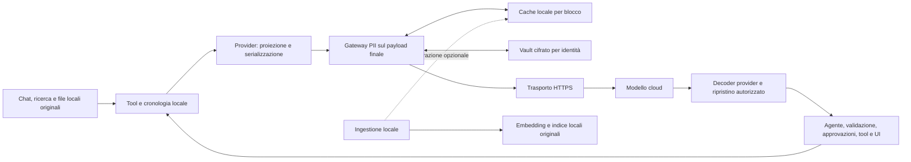

# PII prima dell'HTTPS: gateway, cache e ricostruzione locale

Data: 2026-10-13. Stato: **spec proposta per revisione; protezione non implementata**.
Rischio: alto — isolamento identità, richieste ai modelli, argomenti dei tool e media.
Preparata nel checkout corrente, senza branch/worktree e senza pubblicazione GitHub.

## 1. Intento e decisione

L'operatore vuole un solo sottosistema che sostituisca i dati personali con ID prima
che Aura li invii a un modello cloud e li ricostruisca localmente nella risposta.
I tool non devono implementare ciascuno un detector. Quattro secondi aggiunti a ogni
richiesta sono stati esplicitamente rifiutati. Aprire direttamente un Excel o un PDF
deve avere la stessa protezione del recupero di un documento indicizzato.

La decisione è applicare la policy **al payload finale del modello, dopo la proiezione
dei contenuti e prima del trasporto HTTPS**. Originali, ricerca lessicale, embedding
locali e cronologia locale mantengono i valori originali. Gli ID restituiti dal modello
si risolvono prima che l'agente consumi testo o argomenti dei tool. L'ingestione può
preparare risultati riutilizzabili; non è il confine di protezione.

È pseudonimizzazione reversibile: la corrispondenza ID ↔ valore rimane presso Aura.
Questa spec non dichiara anonimato, riconoscimento perfetto o conformità normativa.
Il contesto rimasto leggibile può comunque consentire inferenze sulla persona.

| Approccio discusso | Valutazione |
|---|---|
| Mascherare solo in ingestione | Scartato come protezione: apertura degli originali, chat e nuovi risultati dei tool lo aggirano. Utile come preparazione della cache. |
| Detector in ogni tool | Scartato: logica duplicata e copertura dipendente dall'implementazione di ogni tool. |
| Policy condivisa alle uscite dei modelli | Scelto: copre il contenuto effettivamente inviato. Richiede pochi adattatori di protocollo, controllo dei media e ricostruzione sul ritorno. |

La scelta del detector NER di produzione resta subordinata alle prove di §10. Non
blocca la definizione del confine; blocca l'attivazione della protezione dichiarata.
Le classi obbligatorie iniziali sono nomi di persona, indirizzi, organizzazioni, email,
telefoni, codice fiscale, partita IVA, IBAN, carte di pagamento e numeri di documento.
Il manifest di policy enumera etichette, soglie e normalizzazioni: aggiungere una classe
o modificarne il significato cambia versione e invalida la cache dipendente.

## 2. Evidenze e limiti

Le evidenze sono su fixture sintetiche, salvo l'audit del codice e della configurazione
accesa. Lo [spike 109](../../../.planning/spikes/109-pii-pseudonymization/README.md)
rimane **PENDING**. Nessuna misura seguente prova che il traffico normale sia protetto.

| Evidenza | Risultato | Cosa non dimostra |
|---|---|---|
| [Trasporto e ritorno sul modello cloud](../verification/2026-10-12-pii-alcatraz-rizzo-lab-vm.md) | 20 occorrenze note intercettate nel baseline; zero nel payload mascherato; 4/4 ricostruzioni di testo e argomenti. Tutti i 24 placeholder in uscita attraversavano più delta. | Detector su dati reali, tool realmente eseguiti, secondo modello, vault persistente e autorizzazioni. |
| [Correzione locale Alcatraz](../verification/2026-10-12-alcatraz-cf-fix-lab-vm.md) | Corretto checksum CF; test di minuscole e 128 varianti di omocodia. Pattern su 2.248 byte: 14,64 ms con tutti i default, 4,83 ms con 11 tipi italiani/generici. | Nomi/indirizzi liberi, sostituzione completa, rete e vault. Gli errori NLP ignorati a monte restano da correggere. |
| [Cache del testo già mascherato](../verification/2026-10-12-pii-cache-lab-vm.md) | Su 20 turni crescenti: 730 → 65 analisi. Nella stessa serie, mediana turni 2–20: 313,73 → 19,82 ms; richiesta finale ripetuta: 0,80 ms. | p95 del gateway, carico concorrente, cache di produzione e KV-cache del provider. Solo pattern Alcatraz. |
| Rizzo, nelle stesse [evidenze di cache](../verification/2026-10-12-pii-cache-lab-vm.md) | Cronologia in cache + domanda breve nuova: 278–293 ms. Nuovo blocco tool: 6,77–7,76 s. | Un percorso interattivo accettabile per tutti i nuovi contenuti. La cache non elimina il costo del miss. |
| [Audit delle uscite](../verification/2026-10-13-pii-egress-audit.md) | Originali apribili; Excel senza passage di testo; media proiettati dai provider; embedding/vision/STT con client separati. Embedder osservato: EmbeddingGemma locale. | Benchmark retrieval, concorrenza embedding/PII o attivazione end-to-end. |

Il cache benchmark termina con 65 blocchi e 53.952 byte. Sul blocco denso da 112.400
byte il percorso Alcatraz completo a freddo richiedeva ancora 2,57–3,37 s. Cache di
soli offset e cache di testo mascherato non hanno lo stesso costo di ricomposizione.
Le misure sono componenti su VM condivisa, non promesse di latenza del prodotto.

### Candidati detector

Alcatraz resta candidato per i pattern verificabili e l'operatore di sostituzione già
esistente. Il pin corretto locale è `666d46451e154fdef4b13e56f99e3d7cd75366c4`, sopra
upstream `9a49e558c80fc54d7936fcedf2cf39cbce795eba`; patch e bundle sono nelle evidenze.
La pubblicazione del fork è rinviata finché l'account GitHub dell'operatore è bloccato.
Non si introduce una dipendenza da un fork remoto inesistente.

Rizzo resta il confronto misurato per il riconoscimento contestuale italiano; il pin
dei pesi provato è `a1c3c83827eca22e9675e30c1111c4641caf5901`. I nove esempi sintetici
riconosciuti non stimano il recall reale. Il suo costo sui nuovi documenti non passa
il requisito interattivo; nessuna cache lo trasforma automaticamente nel detector scelto.

Verifica documentale aggiunta il 2026-10-13 su richiesta dell'operatore:

| Modello pubblicato | Pesi distribuiti | Parametri dichiarati | Lingua indicata |
|---|---|---|---|
| [NVIDIA GLiNER-PII](https://huggingface.co/nvidia/gliner-PII) | [pytorch_model.bin: 1,78 GB](https://huggingface.co/nvidia/gliner-PII/blob/main/pytorch_model.bin) | 570 milioni | Inglese |
| [Rizzo PII 0.3B](https://huggingface.co/rizzoaiacademy/rizzo-pii-0.3B) | [model.safetensors: 1,23 GB](https://huggingface.co/rizzoaiacademy/rizzo-pii-0.3B/tree/main) | circa 300 milioni | Italiano |

GLiNER-PII originale occupa circa il 45% in più per i pesi. Non è stato scaricato né
provato sulla VM: dimensione, numero di parametri, RSS e latenza sono misure distinte.
Quantizzazione, qualità sull'italiano e velocità CPU richiedono prove dedicate prima
di promuoverlo. La sua aggiunta al confronto non cambia il disegno del gateway.

## 3. Confine e responsabilità

Il gateway è un servizio logico condiviso nel processo Go, composto al boot e
iniettato nei client dei modelli. Non introduce un proxy HTTPS con intercettazione
dei certificati. Il trasporto HTTP controllato legge il body ancora in chiaro dopo
la serializzazione SDK e delega alla rete solo il body approvato. I decoder e gli
SDK esistenti restano proprietari dei protocolli dei provider e dello streaming.

Un adattatore di richiesta conosce il formato Responses oppure Chat Completions;
detector, cache, vault, policy e resolver sono unici. Un involucro del `llm.Client`
risolve i chunk già decodificati prima di restituirli ai chiamanti. Il contesto interno
lega le due direzioni alla stessa identità, richiesta e generazione di policy.
Mascherare soltanto `llm.Request.Messages` non soddisfa il contratto.

Prima release proposta: E1/E2 cloud testuali protetti; embedding originali soltanto su
route locali verificate; le altre uscite cloud disabilitate in modalità protetta fino
all'accettazione del loro adattatore. Non è una promessa di mantenere attive tutte le
funzioni multimodali. Un'uscita bloccata è visibile come tale, mai conteggiata come test
positivo di pseudonimizzazione.

| Uscita | Policy in modalità protetta | Punto di integrazione esistente |
|---|---|---|
| E1 chat, swarm, agent job, finalize | Testo attraverso il gateway; media originali rifiutati | `cmd/aura/llm_client.go`, `internal/runner/runner_identity_llm.go`, client `internal/llm/` |
| E2 compaction, titolo, reasoning teacher | Stesso client protetto e stessa identità; nessun costruttore alternativo scoperto | `internal/conversations/`, `internal/agent/llm_agent_reasoning.go` |
| E3 embedding Go | Originali solo verso modello locale verificato; cloud rifiutato | `internal/embeddings/client.go` |
| E4 embedding ingestione Python | Identica policy local-only; nessun invio cloud diretto alternativo | `services/ingest/embed.py` |
| E5 vision, immagini e scansioni PDF | Estrazione locale se disponibile; altrimenti rifiuto, inclusa l'ingestione | `internal/multimodal/vision.go`, `cmd/aura-media-index/main.go` |
| E6 STT | Modello locale verificato o rifiuto | `internal/multimodal/`, client di estrazione |
| E7 TTS della risposta ricostruita | Modello locale verificato o rifiuto | `internal/multimodal/`, configurazione TTS |
| E8 generazione immagini/video | Cloud rifiutato nella prima release protetta | `internal/mediagen/` |

Ogni processo che può chiamare modelli riceve una policy validata; configurazione
mancante/incompatibile in modalità protetta impedisce quella chiamata. Python non
riceve chiavi del vault: nella prima release deve solo consentire la route embedding
locale e rifiutare quella cloud. L'eventuale precomputazione PII usa il servizio locale
autenticato condiviso, dopo una prova separata; non replica il vault nel sidecar.

La classificazione locale richiede un endpoint gestito, senza inoltro a cloud, verificato
nel deployment. `localhost`, URL senza API key o un nome provider non bastano da soli.
Destinazioni e redirect dei client protetti sono vincolati alla route approvata.
Test di costruzione e trasporto devono trovare un client diretto non registrato.

Il perimetro è l'egress dei **modelli chiamati da Aura**. Mail, browser, ricerca web,
MCP remoto e rete arbitraria del sandbox restano soggetti alle autorizzazioni esistenti;
questo gateway non costituisce un filtro universale di quella rete. I tool con effetti
esterni continuano a richiedere il controllo della destinazione e dell'azione prevista.

## 4. Contratto di uscita

Per ogni tentativo di invio, inclusi retry e fallback di provider:

1. Risolvere identità autenticata, route, modalità e versione della policy dal runtime.
   Nessun valore nel prompt o negli argomenti può scegliere l'identità del vault.
2. Ricevere il payload definitivo, dopo proiezione di contenuti nativi e `ToolMedia`.
   Rifiutare formati, endpoint, campi di contenuto o codifiche non supportati.
3. Visitare tutti i campi che trasportano dati: messaggi di ogni ruolo, tool result,
   argomenti storici, profilo, memoria, riassunti, titoli, descrizioni ed esempi dinamici,
   nomi file e metadati. I valori PII possono essere anche chiavi di un oggetto dati.
4. Decodificare le rappresentazioni conosciute prima dell'analisi: stringhe JSON anche
   annidate e contenuto escapato dei frame Aura. Conservare separatamente struttura e
   provenienza; ricodificare senza rimuovere nonce, delimitatori o trust framing.
5. Riutilizzare un risultato esatto valido oppure analizzare tutto il blocco mancante,
   risolvere gli span sovrapposti in modo deterministico e sostituirli con token stabili.
6. Persistire atomicamente le nuove corrispondenze, poi registrare il set di riferimenti
   autorizzato per questa richiesta. Senza commit del vault non parte la chiamata.
7. Ricomporre e validare il payload; solo il trasporto controllato può inviarlo. Il
   risultato della preparazione è legato a body, identità, route e generazione correnti.

Non si esegue una seconda inferenza su tutto il body per dichiararlo controllato: il
trasporto verifica copertura dei campi e validità dei risultati già preparati. Questo
non rende infallibile il detector. Cache hit e blocchi nuovi seguono la stessa policy.

Nomi di funzione, chiavi del protocollo, ID tecnici di tool call e schema restano
struttura: non si applica una regex indiscriminata all'intero JSON. Uno schema dinamico
che incorpori PII in una posizione non trasformabile va rifiutato o adattato con prova
di equivalenza, non esentato. URL/filename dinamici non sono ID tecnici per definizione.
Header e URL di trasporto ammettono solo metadati necessari alla route: niente testo
utente, nomi o email nelle intestazioni di tracing. Le credenziali del provider sono
autenticazione del trasporto, non contenuto da sostituire con un token PII.

Base64, immagini, audio, video, file binari e URL/file ID che consentono al provider
di leggere l'originale non passano il detector testuale. In modalità protetta vengono
rifiutati; l'estrazione locale produce un nuovo testo che attraversa il gateway.
Un limite di dimensione o profondità del parser causa un rifiuto esplicito, mai una
troncatura dell'analisi seguita dall'invio del resto in chiaro.

## 5. Token, vault e autorizzazione

Il token rappresenta un **valore esatto**, non una persona identificata semanticamente.
Due omonimi non diventano una sola entità del grafo; due grafie diverse non vengono
fuse distruggendo l'informazione necessaria al roundtrip.

- Identificatore opaco derivato da HMAC con chiave per identità e dominio PII separato;
  include versione, tipo e almeno 128 bit del digest. Formato ASCII delimitato e a
  lunghezza limitata, da congelare solo dopo la prova sui due provider.
- Stesso valore/tipo/versione nella stessa identità produce lo stesso token; identità
  diverse non lo condividono. Nessun contatore che riparte da `[FULLNAME_1]` a documento.
- Conservare esattamente i byte del valore da ricostruire. Normalizzazione usata dal
  detector non autorizza a modificare accenti, maiuscole, spazi o checksum originali.
- Vault Postgres con RLS tramite `db.WithIdentityTx`; riusare `secret.Sealer` e
  `secret.IdentityKey` con domini separati per cifratura, token e chiavi cache. Il
  binding cifrato comprende identità, token e versione e viene verificato in lettura.
- Record logico: identità, token, tipo, versione chiave, epoca, valore cifrato, stato
  e riferimenti di durata. Vincolo univoco sullo scope; un conflitto con valore diverso
  è errore bloccante, mai sovrascrittura silenziosa.
- Persistenza prima dell'invio; riavvio, eviction o scadenza cache non cancellano il
  vault. I riferimenti necessari a conversazioni e job vivi devono restare risolvibili.
- Rotazione: nuove scritture con nuova versione, vecchie letture finché autorizzate;
  invalidare la cache interessata. Revoca/cancellazione rende i riferimenti inutilizzabili
  e invalida cache e nuove richieste; non recupera dati già trasmessi.

L'esistenza di un token nel vault non è autorizzazione a risolverlo. Il resolver accetta
solo riferimenti registrati nel payload di quella richiesta, della stessa identità e
ancora validi. Input non fidato che imita il formato riservato viene trattato come testo
letterale escapato, non acquisisce un permesso di lookup. Non si offre al modello un
tool per enumerare il vault. Un token sconosciuto, revocato o di altro scope provoca un
errore di risoluzione; nessuna ricerca globale o ricostruzione euristica.

La durata delle mappe è separata dal TTL della cache: rilascio dopo l'ultimo riferimento
persistente, revoca esplicita e cancellazione dell'identità devono essere testati. Un
turno in corso ha uno snapshot di policy con validità verificata prima dell'invio e
della risoluzione; revoca e aggiornamento non possono essere aggirati da un cache hit.

## 6. Ritorno: prima dei tool e della UI

I provider esistenti assemblano i frammenti di argomenti e producono `llm.Chunk` con
tool call finalizzate. Il client protetto risolve quelle call **prima di esporle a
`LlmAgent.consume`**. Parsing sintattico JSON, risoluzione delle stringhe/chiavi dati,
ricodifica JSON valida, poi validazione semantica e consumo normale dell'agente.

Questo ordine copre dedup, fingerprint delle approvazioni, `ask_user`, bozze approvate,
tool terminali, query documentali e scritture in memoria. Nome funzione e ID di call
non si riscrivono. I controlli dei tool restano applicati ai valori effettivamente
usati: ricostruire un destinatario non autorizza a inviargli qualcosa.

Ricodificare JSON non basta quando una stringa contiene codice, shell o una query di
un altro linguaggio. La risoluzione deve preservare quel contesto senza trasformare
apostrofi, virgolette o delimitatori del valore in istruzioni. Prima release: token
ammessi nei parametri dati; sostituzione in contenuti eseguibili solo con un codec del
contesto verificato, altrimenti rifiuto della call e richiesta di riformularla usando
parametri dati. La classificazione degli argomenti appartiene al confine comune e al
contratto del tool, non a un detector aggiunto a ogni tool. G3 deve provare anche questi
casi e impedire l'esecuzione parziale di una call che non si può ricostruire in sicurezza.

Testo e reasoning esposto localmente usano buffer distinti per stream, limitati alla
lunghezza massima del token e al prefisso incompleto. Le porzioni complete vengono
emesse subito; un token diviso fra delta deve essere risolto una sola volta. Errore,
cancellazione o fine stream con token incompleto non devono emettere frammenti di
placeholder come risposta riuscita. Preservare ordine degli eventi, usage, finish,
errori terminali e obbligo di drain/close del client esistente.

Il testo locale persistito conserva la forma ricostruita; la richiesta successiva lo
pseudonimizza di nuovo in modo stabile. Titoli e compaction usano lo stesso confine.
L'output del tool torna originale alla cronologia locale, poi ripassa dal gateway:
aprire un PDF/Excel dopo il primo turno non crea un'eccezione.

## 7. Cache e preparazione in ingestione

L'unità è il blocco/campo completo con input deterministico, non l'intero prompt che
cambia a ogni turno. Cache del **testo già mascherato + riferimenti al vault**, non
soltanto degli span: è l'ottimizzazione misurata più utile sulla storia ripetuta.

La chiave è un digest autenticato, separato per identità, di testo esatto, tipo di campo,
versione del parser/framing, detector e pesi, label/soglie/dizionari/policy, eventuale
contesto usato dal detector, namespace/versione chiavi/epoca del vault. Se un risultato
dipende dai blocchi vicini, anche quegli input devono entrare nella chiave.

Requisiti: limite globale e per identità in byte e voci, TTL e LRU, limite per elemento,
coalescenza dei miss concorrenti, backpressure e cancellazione. Non memorizzare errori
come risultati puliti. Niente riuso di buffer mutabili fra chiamanti. Verificare validità
e autorizzazione delle mappe anche sul hit; cache senza vault non autorizza l'invio.
Il benchmark aveva 128 voci, 8 MiB di accounting e TTL 300 s: sono parametri del probe,
non un dimensionamento già approvato per il deployment multi-identità.

La cache vive localmente in memoria; il testo mascherato può contenere PII non rilevata
e rimane dato sensibile. Log e metriche del gateway registrano conteggi, tempi, versioni,
hit/miss ed errori categorizzati, mai body, valori del vault o token utilizzabili per lookup.
L'audit di risoluzione registra chi, motivo, scope ed esito senza ricopiare il valore.

L'ingestione continua a usare il chunker e la memoizzazione CocoIndex esistenti.
Preparare PII ed embedding originali può avvenire in parallelo **solo se l'embedding è
locale**; pool limitati e priorità al percorso interattivo. Non è richiesto per la
prima release: si aggiunge se un benchmark sullo stack acceso dimostra il beneficio.
Non duplicare il chunker e non inserire detector nei singoli tool.

Un chunk preparato serve solo se il campo inviato ha gli stessi input. Tabelle Excel,
estratti, prefissi, escaping o nonce diversi possono produrre un miss. Non eliminare
trust framing per aumentare gli hit. Un eventuale riuso di sotto-blocchi deve conservare
confini semantici, coprire tutto il testo e superare le prove di entità a cavallo dei
confini; fino ad allora si analizza il campo completo.

## 8. Ricerca, errori e attivazione

L'indice locale conserva `Passage.text`, hash, offset, heading, card e filename originali;
gli embedding dei documenti e delle query mantengono la rappresentazione attuale.
Nessun reindex è richiesto da questa spec. Cercare un nome restituito come ID funziona
risolvendo l'argomento prima di `documents.Retrieve`, non vettorizzando l'ID opaco.
Le citazioni rimangono ancorate all'originale; non usare hash del testo mascherato per
dedup o identità del documento. Cloud embedding richiederebbe una decisione separata,
con trasformazione coerente di documenti/query e misure di retrieval.

Modalità proposta nel catalogo di configurazione: `AURA_PII_MODE=off|required`, usando
il percorso esistente config/settings. `off` indica esplicitamente assenza di questa
protezione; `required` abilita il contratto di questa spec. Default di compatibilità
`off` durante l'introduzione, senza attivazione automatica da questa documentazione.
La modalità desiderata e quella effettiva devono essere distinguibili nelle Settings.
Solo l'amministratore può cambiare la policy di deployment; un tool o un prompt no.

In `required`, errori di detector obbligatorio, timeout, vault, scope, parser o formato
causano **rifiuto prima dell'invio**. Nessun fallback a testo originale o ai soli pattern
quando il NER obbligatorio manca. Anche gli errori NLP silenziosi di Alcatraz devono
diventare errori osservabili prima dell'adozione. Un fallback a modello locale deve
essere configurato e verificato; non viene inventato durante un guasto.

I messaggi all'utente distinguono analisi in corso, contenuto non supportato e servizio
indisponibile, senza dichiarare riuscita una richiesta non inviata. Un rollback del
detector mantiene il blocco delle uscite cloud protette finché non è sana una versione
accettata. Disabilitare la protezione è una modifica amministrativa esplicita, mai la
reazione automatica a un errore. Cambiare modalità non riscrive turni già in corso.
Ogni successivo invio verifica però la policy attuale: una richiesta preparata ma non
ancora inviata viene invalidata e ripreparata se la modalità cambia. Il ritorno di una
chiamata già inviata conserva il proprio contesto di risoluzione, soggetto alle revoche.

## 9. Componenti e riuso

I percorsi nuovi sotto sono responsabilità proposte, non file già implementati.
Prima del piano esecutivo completare l'inventario API delle versioni effettivamente
installate: non copiare il prodotto Rizzo o codice di altre applicazioni dentro Aura.

| Responsabilità | Target e riuso |
|---|---|
| Policy, detector, token, vault, cache e resolver condivisi | Nuovo `internal/pii/`, file distinti per responsabilità, ciascuno ≤600 LOC; riusare sostituzione Alcatraz e primitive `internal/secret/` |
| Adattatori body finali e risposta decodificata | `internal/llm/chatgpt/`, `internal/llm/openai_compat/`, nuovo trasporto condiviso e client protetto; SDK esistenti, nessun parser SSE parallelo |
| Wiring e identità | `cmd/aura/llm_client.go`, `internal/runner/runner_identity_llm.go`, composizione dei client secondari |
| Vault persistente | `internal/db/queries/`, migration RLS, codice sqlc generato; pattern `internal/identitykey/store.go` |
| Blocco delle uscite non supportate | `internal/embeddings/`, `services/ingest/embed.py`, `internal/multimodal/`, `cmd/aura-media-index/`, `internal/mediagen/` |
| Configurazione e stato reale | `internal/config/`, catalogo settings esistente e `.env.example`; una policy, nessun interruttore per tool |
| Preparazione opzionale dei documenti | `services/ingest/app.py` e memoizzazione esistente; solo dopo misura di parallelismo e contratto locale autenticato |
| Verifiche di comportamento | Test client/trasporto, vault con DB reale, cache/race, agent special paths, cache-audit e smoke VM |

È necessaria una migration additiva per il vault. Il numero si determina leggendo
`internal/db/migrations/` quando si prepara il piano; non viene prenotato qui.
Nessuna modifica dei dati indicizzati esistenti. Un down/rollback non deve eliminare
mappe ancora necessarie a turni attivi. Chiavi master mai distribuite ai sidecar.

## 10. Accettazione e criteri di rilascio

Tutte le righe sono **da eseguire** sul prodotto integrato. I risultati parziali di §2
non le spuntano. Nuove evidenze in `docs/superpowers/verification/`, con revisioni,
modelli/pesi, policy, risorse, fixture, comandi e limiti della prova.

| Gate | Prova e criterio |
|---|---|
| G1 — Copertura uscite | Inventario E1–E8 sul deployment. In `required`, ogni chiamata attraversa il percorso ammesso o viene rifiutata. Client diretto, retry, redirect, side call e configurazione Python incompatibile non inviano contenuti originali al cloud. |
| G2 — Excel/PDF e contenuto finale | L'agente reale apre XLSX e PDF originali sintetici e legge nomi/CF/IBAN mai presenti nella cache. Sul body finale decodificato: zero occorrenze note non mascherate. Includere JSON annidato, chiavi dati, escaping, Unicode, filename, metadati e media proiettati. |
| G3 — Ripristino e tool | Due modelli/protocolli della matrice release, almeno 10 run ciascuno: ≥99% dei riferimenti restituiti integri; successo task non oltre 1/20 sotto il baseline. Riferimento non valido rifiutato, mai mandato al tool come valore reale. Coprire `ask_user`, bozze, tool terminale, dedup e approvazioni. |
| G4 — Retrieval | Query con nome originale e query equivalente con token risolto producono gli stessi argomenti locali, candidati e citazioni del baseline sul corpus fisso; nessuna modifica di testo/hash/offset/vettori. Test di omonimi e nomi ripetuti in documenti diversi. |
| G5 — Streaming | Spezzare token a ogni posizione fra delta, con più call e reasoning intercalato. Ricostruzione esatta in UI e storia, nessun token parziale emesso, nessun tool eseguito su risoluzione fallita. Errori/cancel non diventano successi; niente leak di goroutine/connessioni. |
| G6 — Vault e isolamento | DB con RLS reale, riavvio, rotazione, cancellazione, identità errata, token imitato e collisione simulata. Persist-before-send, risoluzione solo per riferimenti autorizzati, nessuna lettura cross-identità. Revoca concorrente invalida hit e richieste non ancora inviate. |
| G7 — Guasti | Arrestare detector/vault e provocare timeout, risposta NLP errata e saturazione. Zero richieste originali al cloud; errore visibile, cache non avvelenata e recupero con identità corretta. |
| G8 — Media | Immagine con nome, scansione PDF, audio, data URL e riferimento remoto all'originale: estrazione locale verificata o rifiuto. Stesso esito nel percorso ingestione. TTS cloud non riceve risposta già ricostruita. |
| G9 — Cache | Output identico con/senza cache; invalidazione di ogni input rilevante; TTL/eviction non distruggono il vault. Miss concorrenti coalescenti, race/goleak, limite globale e per identità. `cache-audit` osserva il payload sotto il gateway; prova live separata di `cached_tokens`. |
| G10 — Qualità detector | Corpus italiano locale etichettato di almeno 200 elementi, distinto dal training: recall/precision e falsi negativi per tipo, nomi/indirizzi/organizzazioni e pattern verificabili. Zero omissioni sulle fixture di regressione note; pubblicare errori residui sul corpus. Nessuna conclusione di protezione universale da una media F1. |
| G11 — Prestazioni | VM attiva con carico Aura ed embedding: almeno 100 campioni per classe, ordine alternato dei candidati, p50/p95, RSS e contesa. Misurare tempo dalla richiesta pronta al primo byte inviabile, includendo detector, cache, vault e ricomposizione, separato dal tempo del provider. |

Per G10 la proposta di soglia di prodotto è recall ≥99% per ciascuna classe obbligatoria
con almeno 50 occorrenze etichettate e precision ≥95%; riportare denominatori e intervalli
di confidenza, non equiparare il campione alla popolazione. Sono **soglie proposte**, non
risultati misurati né una promessa di assenza di PII. Un tipo non rappresentato resta non
validato. Contenuti sanitari o altre informazioni sensibili senza etichette adeguate
non diventano protetti solo perché il nome è sostituito.

Per G11 i budget proposti per la prima release sono: p95 ≤50 ms per richiesta ripetuta
da circa 54 KB, ≤500 ms per storia in cache con un nuovo blocco fino a 2,3 KB. Riportare
separatamente input densi da 112,4 KB, avvio modello e carico concorrente. Questi budget
sono obiettivi da verificare, non misure già ottenute; Rizzo sui nuovi documenti non li
soddisfa nelle prove disponibili. Un input maggiore resta esplicitamente in preparazione
locale o viene rifiutato al limite operativo: niente invio anticipato in chiaro.

G1–G11 sono gate per l'attivazione; se qualità o latenza falliscono, si mantiene la
feature disabilitata e si confronta un altro detector/runtime. Non si abbassa la copertura
silenziosamente per rispettare il tempo. Per codice Go valgono vet/build/test/race e i
gate di copertura del repository; la chiusura richiede il run con agente reale su VM.

## 11. Handoff

Questa consegna contiene spec ed evidenze, non un piano esecutivo o una modifica runtime.
Prima del piano: revisione della spec, scelta del candidato che soddisfi qualità e
latenza oppure piano esplicito delle misure mancanti; inventario API e licenze della
versione da distribuire. Prima dell'implementazione, registrare nel PRD solo risultati
misurati e contratti accettati, distinguendo sempre ciò che resta da provare.

Il piano successivo deve mantenere separati: gateway/vault/ripristino, copertura delle
uscite, prove complete e precomputazione opzionale. La cache dell'ingestione non può
diventare un prerequisito che lascia scoperte le aperture dirette dei file.
Nessun branch richiesto per questa spec e nessuna operazione GitHub finché resta il
blocco comunicato dall'operatore.
